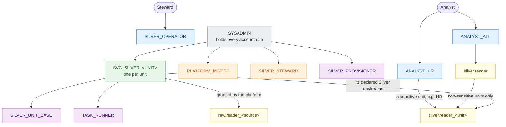
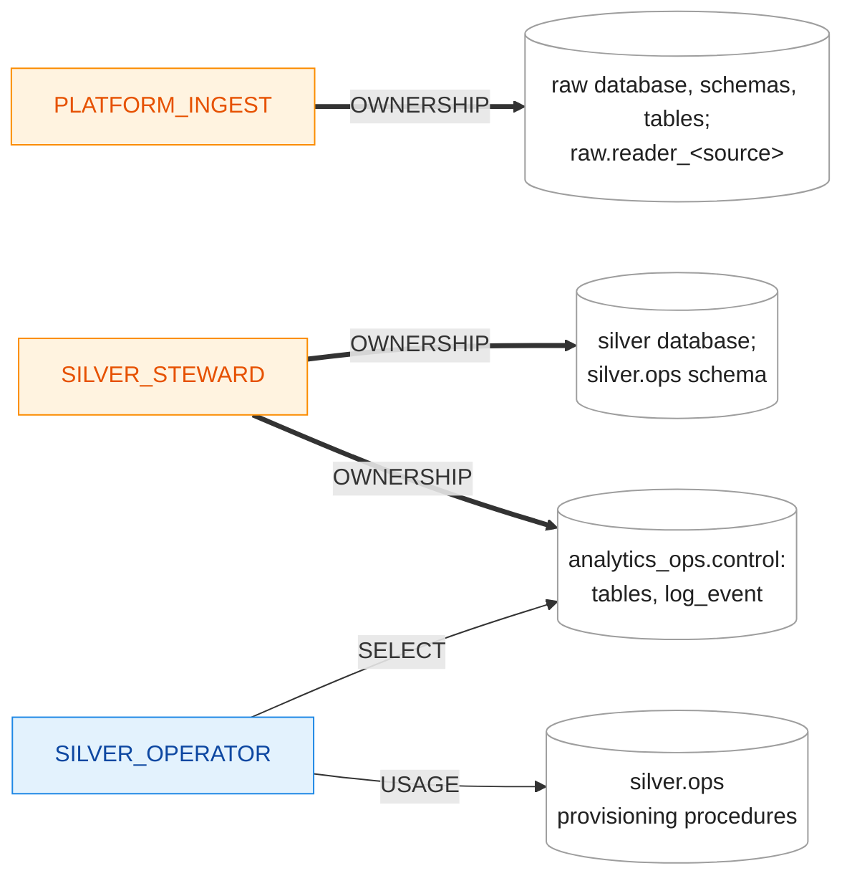
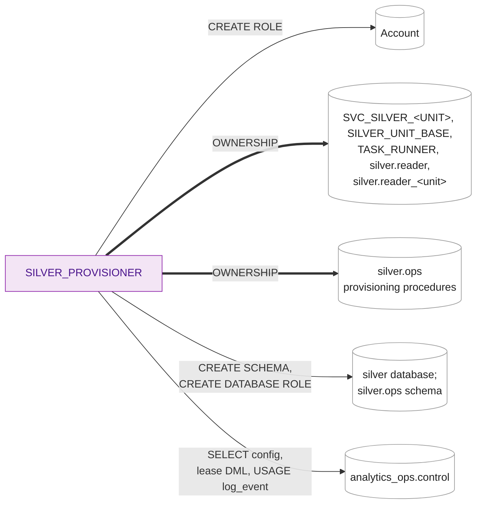
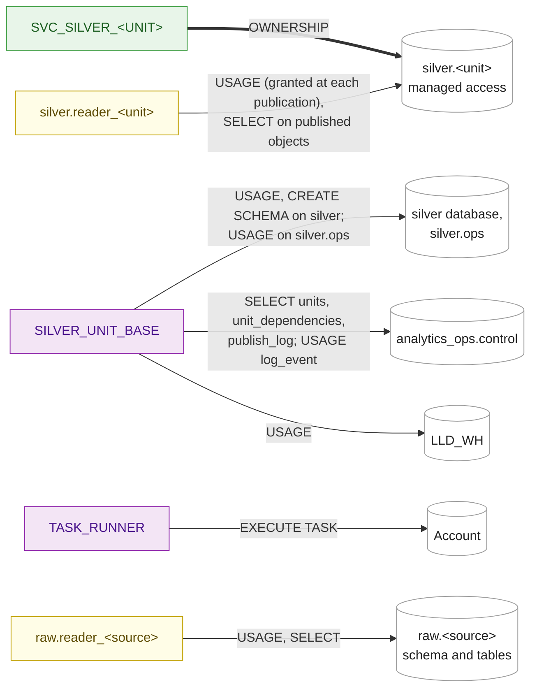

# Access map

A quick reference to the roles, what they hold, what they own and what they may do, **as built in the prototype** (Increment 1, 2026-10-12). The design and its reasons are in [`01-identity-and-access.md`](01-identity-and-access.md); this page shows the result. It is updated in every increment's pull request that changes a role, an ownership or a grant.

Ownership is drawn as a privilege (`OWNERSHIP`), as Snowflake treats it: thick arrows are `OWNERSHIP`, thin arrows are other privileges. `<unit>` stands for each Silver unit (`erp`, `crm`, `hr`, `core`), `<source>` for each raw source.

**Colours:** grey system role · blue functional role (people) · orange owner role · purple utility or access role · green service role (one per unit) · yellow database role.

## 1. Who holds which role

An arrow points from the holder to the role it holds, so privileges flow against the arrow. Every account role is also granted to `SYSADMIN`; only the top-level ones are drawn.

Examples from the demo: `SVC_SILVER_CORE` holds `silver.reader_erp` and `silver.reader_crm` (its declared upstreams), not `silver.reader_hr`. `silver.reader` holds the readers of ERP, CRM and Core; HR is sensitive, so only `ANALYST_HR` reaches `silver.reader_hr`.

## 2. Owners, provisioning and operation

## 3. A unit and its readers

## 4. Matrix

| Role | Kind | Holds | `OWNERSHIP` of | Other privileges |
|---|---|---|---|---|
| `SYSADMIN` | System | Every account role below | `LLD_WH`, `LLD_LAB` | |
| `PLATFORM_INGEST` | Owner | | `raw` database, `raw.<source>` schemas and tables, `raw.reader_<source>` | `USAGE` on `LLD_WH` |
| `SILVER_STEWARD` | Owner | | `silver` database, `silver.ops`, `analytics_ops` and everything in `analytics_ops.control` (tables, `log_event`) | `USAGE` on `LLD_WH` |
| `SILVER_PROVISIONER` | Utility | | `SILVER_UNIT_BASE`, `TASK_RUNNER`, every `SVC_SILVER_<UNIT>`; `silver.reader`, every `silver.reader_<unit>`; the procedures in `silver.ops` | `CREATE ROLE` on the account; `USAGE`, `CREATE SCHEMA`, `CREATE DATABASE ROLE` on `silver`; `USAGE`, `CREATE PROCEDURE` on `silver.ops`; `SELECT` on `units`, `unit_dependencies`; `SELECT`, `INSERT`, `DELETE` on `unit_lease`; `USAGE` on `log_event`; `USAGE` on `LLD_WH` |
| `SILVER_UNIT_BASE` | Access | | | `USAGE`, `CREATE SCHEMA` on `silver`; `USAGE` on `silver.ops`; `USAGE` on `analytics_ops`, `analytics_ops.control`; `SELECT` on `units`, `unit_dependencies`, `publish_log`; `USAGE` on `log_event`; `USAGE` on `LLD_WH` |
| `TASK_RUNNER` | Access | | | `EXECUTE TASK` on the account (INC1.90) |
| `SVC_SILVER_<UNIT>` | Service | `SILVER_UNIT_BASE`, `TASK_RUNNER`; `raw.reader_<source>` (Source Entity units, from the platform); `silver.reader_<upstream>` for each declared Silver upstream | `silver.<unit>` (managed access); from Increment 2, `silver.<unit>__build` and its task | Through the roles it holds |
| `SILVER_OPERATOR` | Functional | | | `USAGE` on `onboard_unit`, `offboard_unit`, `grant_unit_reader`, `revoke_unit_reader`; `SELECT` on `units`, `unit_dependencies`, `publish_log`, `unit_lease`; `USAGE` on `LLD_WH` |
| `ANALYST_ALL` | Functional (consumer) | `silver.reader` | | `USAGE` on `LLD_WH` |
| `ANALYST_HR` | Functional (consumer) | `silver.reader_hr` | | `USAGE` on `LLD_WH` |
| `raw.reader_<source>` | Database role | | | `USAGE` on `raw.<source>`; `SELECT` on its tables, present and future |
| `silver.reader` | Database role | Every non-sensitive `silver.reader_<unit>` | | |
| `silver.reader_<unit>` | Database role | | | `USAGE` on `silver.<unit>`, granted at each publication (F3; INC1.42 stands in until Increment 2); `SELECT` on published objects (dbt `grants`, Increment 2) |

Every prototype role also has `USAGE` on `LLD_LAB.EVIDENCE` and its procedures, and `INSERT` on the evidence table (trial shortcut T6). Trial shortcut T1: the one trial user holds every role; in production people hold functional roles only.
