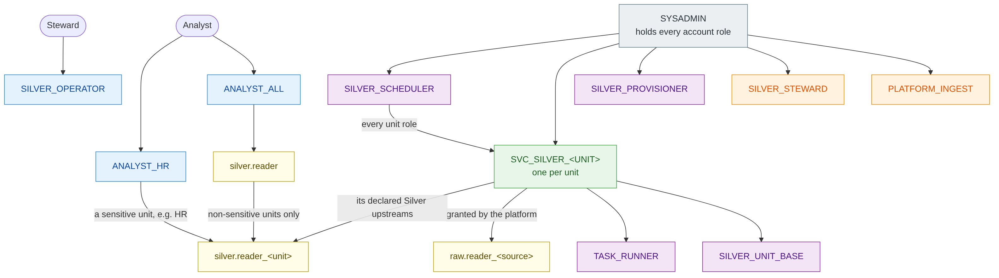
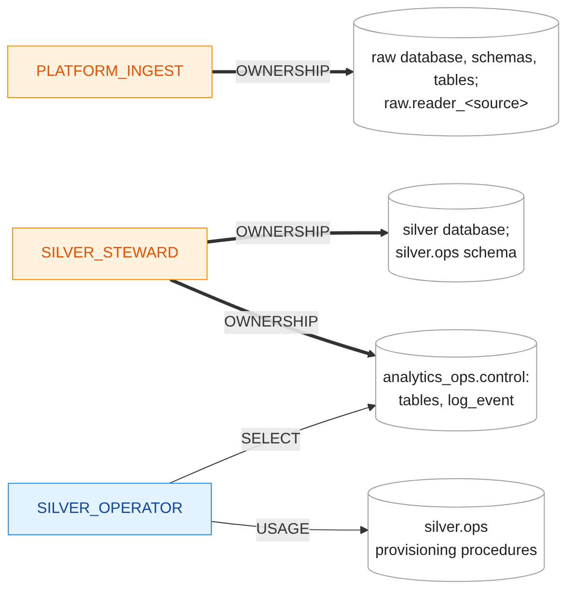
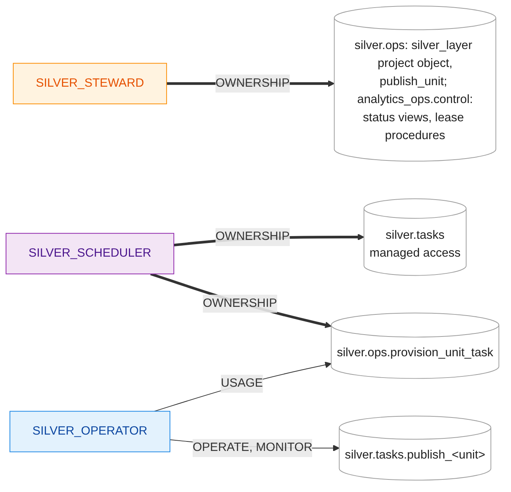
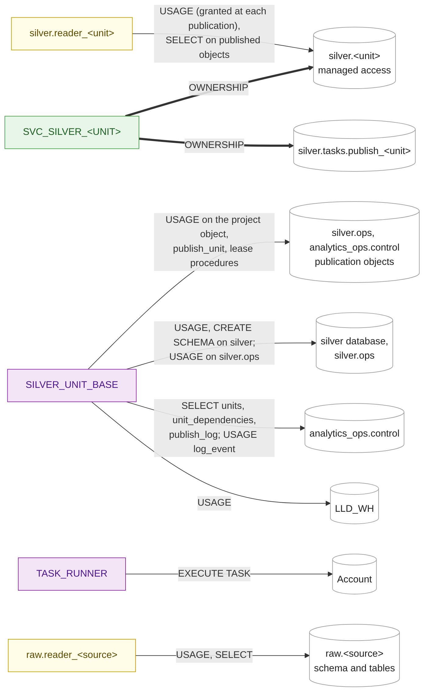

# Access map

A quick reference to the roles, what they hold, what they own and what they may do, **as built in the prototype** (Increments 1 and 2, 2026-10-12). The design and its reasons are in [`01-identity-and-access.md`](01-identity-and-access.md); this page shows the result. It is updated in every increment's pull request that changes a role, an ownership or a grant.

The diagrams are PNG images, so they display in any Markdown viewer. Their source is Mermaid, one `.mmd` file per diagram in [`diagrams/`](diagrams/); after editing one, regenerate the images with `docs/lld/diagrams/render.sh`.

Ownership is drawn as a privilege (`OWNERSHIP`), as Snowflake treats it: thick arrows are `OWNERSHIP`, thin arrows are other privileges. `<unit>` stands for each Silver unit (`erp`, `crm`, `hr`, `core`), `<source>` for each raw source.

**Colours:** grey system role · blue functional role (people) · orange owner role · purple utility or access role · green service role (one per unit) · yellow database role.

## 1. Who holds which role

An arrow points from the holder to the role it holds, so privileges flow against the arrow. Every account role is also granted to `SYSADMIN`; only the top-level ones are drawn.

`SILVER_SCHEDULER` holds every unit role because, in its managed-access schema `silver.tasks`, a task can be handed only to a role below the schema owner (INC2.10, first run).

Examples from the demos: `SVC_SILVER_CORE` holds `silver.reader_erp` and `silver.reader_crm` (its declared upstreams), not `silver.reader_hr`. `silver.reader` holds the readers of ERP, CRM and Core; HR is sensitive, so only `ANALYST_HR` reaches `silver.reader_hr`.

## 2. Owners, provisioning and operation

## 3. Publication: the steward's objects and the scheduler

The scheduler creates each task and hands it to the unit role; the operator starts it with `EXECUTE TASK`, and the run is the unit role's (INC2.15, INC2.19).

## 4. A unit and its readers

## 5. Matrix

| Role | Kind | Holds | `OWNERSHIP` of | Other privileges |
|---|---|---|---|---|
| `SYSADMIN` | System | Every account role below | `LLD_WH`, `LLD_LAB` | |
| `PLATFORM_INGEST` | Owner | | `raw` database, `raw.<source>` schemas and tables, `raw.reader_<source>`; `raw.control` (`landing_complete`, `land_batch`) | `USAGE` on `LLD_WH`; grants `SELECT` on `landing_complete` to `SILVER_STEWARD` |
| `SILVER_STEWARD` | Owner | | `silver` database, `silver.ops`; the project object `silver.ops.silver_layer` and `silver.ops.publish_unit`; `analytics_ops` and everything in `analytics_ops.control` (tables, status views, `log_event`, lease procedures) | `READ` on `LLD_LAB.GIT.LLD_REPO`; `USAGE` on `LLD_WH` |
| `SILVER_PROVISIONER` | Utility | | `SILVER_UNIT_BASE`, `TASK_RUNNER`, every `SVC_SILVER_<UNIT>`; `silver.reader`, every `silver.reader_<unit>`; the procedures in `silver.ops` | `CREATE ROLE` on the account; `USAGE`, `CREATE SCHEMA`, `CREATE DATABASE ROLE` on `silver`; `USAGE`, `CREATE PROCEDURE` on `silver.ops`; `SELECT` on `units`, `unit_dependencies`; `SELECT`, `INSERT`, `DELETE` on `unit_lease`; `USAGE` on `log_event`; `USAGE` on `LLD_WH` |
| `SILVER_SCHEDULER` | Utility | Every `SVC_SILVER_<UNIT>` (granted by `onboard_unit`) | `silver.tasks` (managed access); `silver.ops.provision_unit_task` | `USAGE`, `CREATE SCHEMA` on `silver`; `USAGE`, `CREATE PROCEDURE` on `silver.ops`; `SELECT` on `units`, `unit_lease`; `USAGE` on `log_event`; `USAGE` on `LLD_WH`; as schema owner, grants `OPERATE`, `MONITOR` on each task |
| `SILVER_UNIT_BASE` | Access | | | `USAGE`, `CREATE SCHEMA` on `silver`; `USAGE` on `silver.ops`, `silver.tasks`; `USAGE` on the project object and `publish_unit`; `USAGE` on `analytics_ops`, `analytics_ops.control`; `SELECT` on `units`, `unit_dependencies`, `publish_log`, `unit_status`, `unit_has_new_input`, `v_landing_complete`; `USAGE` on `log_event`, `acquire_lease`, `release_lease`; `USAGE` on `LLD_WH` |
| `TASK_RUNNER` | Access | | | `EXECUTE TASK` on the account (INC1.90) |
| `SVC_SILVER_<UNIT>` | Service | `SILVER_UNIT_BASE`, `TASK_RUNNER`; `raw.reader_<source>` (Source Entity units, from the platform); `silver.reader_<upstream>` for each declared Silver upstream | `silver.<unit>` and `silver.<unit>__build` (managed access) and every object in them; its task `silver.tasks.publish_<unit>` | Through the roles it holds; as schema owner, grants and revokes `USAGE` for its reader around each swap |
| `SILVER_OPERATOR` | Functional | | | `USAGE` on `onboard_unit`, `offboard_unit`, `grant_unit_reader`, `revoke_unit_reader`, `provision_unit_task`; `OPERATE`, `MONITOR` on each unit task; `SELECT` on `units`, `unit_dependencies`, `publish_log`, `unit_lease`, `unit_status`, `unit_has_new_input`, `v_landing_complete`; `USAGE` on `LLD_WH` |
| `ANALYST_ALL` | Functional (consumer) | `silver.reader` | | `USAGE` on `LLD_WH` |
| `ANALYST_HR` | Functional (consumer) | `silver.reader_hr` | | `USAGE` on `LLD_WH` |
| `raw.reader_<source>` | Database role | | | `USAGE` on `raw.<source>`; `SELECT` on its tables, present and future |
| `silver.reader` | Database role | Every non-sensitive `silver.reader_<unit>` | | |
| `silver.reader_<unit>` | Database role | | | `USAGE` on `silver.<unit>`, granted by the unit role around each swap (F3; INC2.26); `SELECT` on every model in the unit's folder (dbt `grants`; INC2.25, INC2.30) |

Every prototype role also has `USAGE` on `LLD_LAB.EVIDENCE` and its procedures, and `INSERT` on the evidence table (trial shortcut T6). Trial shortcut T1: the one trial user holds every role; in production people hold functional roles only.
