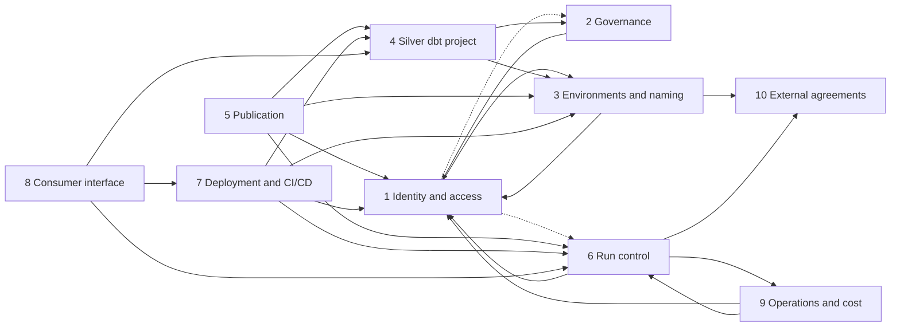

# Component Map

The LLD is organised into ten components. For each one, this document lists what it owns, what it exchanges with other components, where the reference implementation is (HLD sections and the spike skeleton in `setup/` and `dbt/silver/`), and its open decisions (ids from `decision-register.md`).

The point of the map is the **dependencies**: a decision in one component often narrows the choices in another. The dependencies are listed per component, and summarised in the diagram and the order of work at the end.

## Summary

| # | Component | Owns | Key decisions |
|---|---|---|---|
| 1 | Identity and access | Roles, users, ownership, grants | IA-1 to IA-8 |
| 2 | Data governance | Classification tags, masking and row access policies, declassification | GV-1 to GV-5 |
| 3 | Environments and naming | Databases, schemas, naming conventions, dev/CI/prod separation, retention | EN-1 to EN-5 |
| 4 | Silver dbt project | Project structure, macros, selectors, models, tests, generators | SP-1 to SP-5 |
| 5 | Publication | Publish procedure, clone, freeze, swap, input clones, canonical state | PB-1 to PB-4 |
| 6 | Run control and orchestration | Event log, lease, configuration, status views, tasks, alerting | RC-1 to RC-4 |
| 7 | Deployment and CI/CD | Git integration, pipelines, `ADD VERSION`, runtime pinning, Slim CI | CD-1 to CD-4 |
| 8 | Consumer interface | Generated source package, consumer manifest registry, impact analysis, versioning | CI-1 to CI-3 |
| 9 | Operations and cost | Warehouses, resource monitors, cost attribution, disaster recovery | OC-1 to OC-4 |
| 10 | External agreements | Ingestion contract, service levels, platform prerequisites | EX-1 to EX-3 |

---

## 1. Identity and access

**Owns:** the role catalogue (system, owner, service, CI, developer, consumer and governance roles); database roles for consumer access; users and how they authenticate; object ownership; the grant mechanics that publication relies on (managed access, the grant–swap–revoke sequence, dbt `grants` config); the privileges that input clones need.

**Provides to others:** role names and their privileges to every component; the reader database roles that publication (5) grants and revokes around the swap; the task-owner roles that run control (6) uses; the CI and deployment roles that CI/CD (7) uses; the roles that masking policies (2) reveal clear values to.

**Needs from others:** naming conventions and environment layout (3); which roles must read clear PII (2); the task layout (6), since a task is owned by one role.

**Reference:** SLD 3.1 (caller's rights, own service role per unit), 10.4 ("Roles"), 10.7 rule 5, 10.9 (privileges), 10.12; Overview 4.3, 10. Skeleton: `setup/02`, `05`, `06`, `08` (grants), `10`. Spikes S2, S8, S10, S12.

**Open:** IA-1 to IA-8. Document: [`01-identity-and-access.md`](01-identity-and-access.md).

## 2. Data governance

**Owns:** the governance database; classification tags (`PROPAGATE = ON_DEPENDENCY_AND_DATA_MOVEMENT`) and their allowed values; masking policies per tag and per data type; the reserved `declassified` value and its review; row access policies, if any; the CI check that derived columns carry their tags.

**Provides to others:** tags for raw tagging (10, platform) and for the base-model generator (4); the CI tag check (7).

**Needs from others:** the roles that see clear values (1); the onboarding flow for new sources (4).

**Reference:** SLD 6.3, 7.4; Overview 7.3, 10. Skeleton: `setup/05`. Spikes S9 to S9f.

**Open:** GV-1 to GV-5.

## 3. Environments and naming

**Owns:** databases and schemas per tier and environment (production, CI, development); naming conventions for databases, schemas, roles, warehouses, tasks and project objects; per-developer and per-pull-request environments; Time Travel retention for Silver and analytics schemas; how Tier 1 and Tier 2 projects import canonical state.

**Provides to others:** names to everything; the dbt targets (`prod_<unit>`, `ci`, `dev`) that the Silver project (4) and CI/CD (7) use.

**Needs from others:** the role model (1), since an environment is mostly a set of grants; the account strategy (10, EX-3).

**Reference:** SLD 5.2, 7.4, 10.3, 10.11; Overview 6.1. Skeleton: `dbt/silver/profiles.yml`, `macros/unit_schemas.sql`. Spike S6, S9c (retention).

**Open:** EN-1 to EN-5.

## 4. Silver dbt project

**Owns:** project structure (one folder per source module, plus Core); the `ref`, `source` and `generate_schema_name` overrides; the freeze macro; unit selectors (closed under the unit); model types and materialisations; test placement and severities; the changed-key pattern; durable keys in crosswalks; generators for base models and tags.

**Provides to others:** selectors and targets to publication (5); the manifest to the consumer interface (8); the code that CI/CD (7) deploys.

**Needs from others:** schema and target conventions (3); tags (2); input-clone mapping (5, `input_clones` from `unit_dependencies` in 6).

**Reference:** SLD 6, 7, 8, 9, 10.3, 10.5. Skeleton: `dbt/silver/`. Spikes S1, S4, S6, S10.

**Open:** SP-1 to SP-5.

## 5. Publication

**Owns:** the generic publish procedure: lease, gate, clone `WITH MANAGED ACCESS`, input clones, freeze, build, grant–swap–revoke, canonical compile, logging; failure classification; semantic-view handling; the object-identity option per unit (A by default).

**Provides to others:** `STARTED`, `PUBLISHED`, `FAILED`, `SKIPPED` events to run control (6); canonical state query ids to CI/CD (7).

**Needs from others:** service and reader roles (1); lease and log procedures (6); selectors and targets (4); schema names (3).

**Reference:** SLD 10 (all), 11.2. Skeleton: `setup/08`. Spikes P3, S1, S2, S3, S8, S10.

**Open:** PB-1 to PB-4.

## 6. Run control and orchestration

**Owns:** `analytics_ops.control`: `publish_log`, `unit_lease`, `units`, `unit_dependencies`, `v_landing_complete`, `unit_status`, `unit_freshness`, `unit_has_new_input`, `consumer_sources`; the owner's-rights `log_event` and lease procedures; tasks and schedules; alerting; configuration deployment (ops repository).

**Provides to others:** the gate and the lease to publication (5); `unit_status` to the source package (8); the `DEPLOYED` event path to CI/CD (7); the registry table to the consumer interface (8).

**Needs from others:** task-owner roles (1); the landing-complete table (10); warehouses (9).

**Reference:** SLD 11, 12. Skeleton: `setup/06`, `08`, `spikes/S12_unit_lease/`. Spikes S3, S8, S12.

**Open:** RC-1 to RC-4.

## 7. Deployment and CI/CD

**Owns:** Git integration objects and their secrets; CI pipelines for the Silver project and for Tier 1 and Tier 2 projects; deployment by `ALTER DBT PROJECT ... ADD VERSION`; runtime pinning and upgrades; Slim CI with `IMPORTS` of canonical state; `dbt deps` in CI; the `DEPLOYED` event; the tag check in CI.

**Provides to others:** released code to publication (5); the source package release to the consumer interface (8); registry rows (8).

**Needs from others:** CI and deployment roles (1); CI environments (3); canonical state query ids (5, 6).

**Reference:** SLD 3.2, 3.3, 10.11; Overview 2.1, 6.2. Skeleton: `setup/03`, `04`, `07`. Spikes P0, S6, S8 (c to g).

**Open:** CD-1 to CD-4.

## 8. Consumer interface

**Owns:** the generated Silver source package (sources, `upstream_fresh`, the deprecation test; no models); its repository, version tags and release; the consumer manifest registry; the impact query; the versioning and deprecation process.

**Provides to others:** source definitions to Tier 1 and Tier 2 projects; impact analysis to stewards.

**Needs from others:** the Silver manifest (4); `unit_status` (6); a release step (7); reader roles (1).

**Reference:** SLD 12.8, 12.9, 13; Overview 6, 8.

**Open:** CI-1 to CI-3.

## 9. Operations and cost

**Owns:** warehouses and their sizing; resource monitors; object and query tags for cost attribution; disaster recovery (replication or failover groups, or rebuild from raw).

**Provides to others:** warehouses to the dbt profiles (4) and tasks (6).

**Needs from others:** the role model (1) for warehouse grants; the task layout (6); production-volume clone time (S5).

**Reference:** SLD 2, 7.4, 10.10, 16; Overview 10. Skeleton: `setup/00` (warehouse, resource monitor).

**Open:** OC-1 to OC-4.

## 10. External agreements

Not designed here, but other components depend on them.

**Owns:** the ingestion contract with the platform team (`_loaded_at`, source ordering column, landing-complete record, cloneable raw tables, Time Travel retention); service-level targets per source and the steward review turnaround; platform prerequisites (live-version dbt project objects on the production account, edition, account settings).

**Provides to others:** the landing-complete table (6), raw retention (5, 9), service levels as tolerances (6).

**Reference:** SLD 1.2, 3.2, 4; Overview 2.

**Open:** EX-1 to EX-3.

---

## Dependencies

An arrow `A --> B` means *A needs decisions from B*.

Dotted arrows are weaker: identity and access needs only an interface from governance (which roles see clear values) and from run control (which role owns a task).

Two pairs depend on each other:

- **Identity and access and environments and naming.** Roles are named by the conventions, and an environment is mostly a set of grants. Resolved by designing identity and access with the spike names as placeholders, then fixing the names in component 3.
- **Identity and access and governance.** Policies reveal clear values to roles, and which roles may see clear values is a governance call. Resolved by identity and access defining a role for that purpose (an access role for clear PII), and governance deciding who holds it.

## Order of work

1. **Identity and access** (1), with placeholder names.
2. **Environments and naming** (3): fixes the names used in 1.
3. **Governance** (2): masking per data type, clear-value readers, declassification.
4. **Silver dbt project** (4) and **publication** (5): mostly specifying what the skeleton already does, plus SP-1 to SP-4.
5. **Run control** (6) and **deployment and CI/CD** (7).
6. **Consumer interface** (8) and **operations and cost** (9).

External agreements (10) run in parallel throughout; EX-1 (the ingestion contract) blocks the first production source, not the design.
